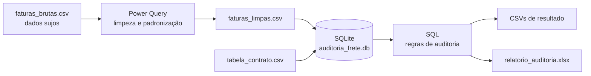

# Auditoria de Fatura de Frete (SQL + Power Query + Excel + Python)

Projeto de portfólio que simula o trabalho de **conferir se as transportadoras cobraram o que estava contratado em contrato**.

> **Todos os dados são fictícios**, gerados por script com semente fixa. Nenhuma empresa, preço ou fatura real foi usada.

## O problema

Todo mês as transportadoras mandam faturas. Cada fatura diz quanto cobrar por um embarque. Em contrato, porém, já ficou combinado **quanto deveria custar** aquele embarque. Conferir isso fatura por fatura, à mão, não funciona quando há centenas de linhas. O projeto automatiza essa conferência e responde:

- Quais faturas vieram **acima do combinado** e quanto dinheiro isso representa?
- Qual transportadora e qual rota concentram o problema?
- Houve embarque **cobrado duas vezes**?
- Alguém cobrou uma rota que **nem existe no contrato**?

## Conceitos usados

| Termo | O que significa |
|---|---|
| **Tarifa por kg** | Preço combinado por quilo transportado em uma rota (ex.: R$ 0,36 por kg de Campinas a São Paulo). |
| **Frete mínimo** | Valor mínimo por embarque. Carga pequena não paga menos que isso. |
| **Valor de tabela** | O que o contrato diz que deveria ser cobrado: o **maior** entre `peso x tarifa por kg` e o `frete mínimo`. |
| **Divergência** | Diferença entre o valor cobrado e o valor de tabela. |
| **Vigência** | Período em que uma tarifa vale. Em julho/2026 as tarifas sobem 5% (reajuste previsto em contrato). |
| **CT-e** | Documento que identifica **um** embarque. Se o mesmo CT-e aparece em duas faturas, houve cobrança em duplicidade. |

Exemplo: 100 kg em uma rota com tarifa de R$ 0,36/kg e frete mínimo de R$ 72. `100 x 0,36 = R$ 36`, que é menos que o mínimo. O valor de tabela é **R$ 72**. Se a transportadora cobrou R$ 90, a divergência é **+ R$ 18**.

## Como o projeto funciona



1. **Power Query** limpa os dados brutos (a parte "suja" do mundo real).
2. **SQL** cruza as faturas limpas com o contrato e aponta as divergências.
3. **Excel** apresenta o resumo, repetindo a regra com fórmulas (a tolerância é editável).

## Estrutura de pastas

```
auditoria-fatura-frete/
├── dados/
│   ├── brutos/        faturas sujas, contrato, rotas e tabelas de-para
│   └── tratados/      faturas_limpas.csv (resultado esperado do Power Query)
├── power_query/       limpeza_faturas.m (código M comentado)
├── sql/               01_criar_tabelas, 02_auditoria (views), 03_resumos (perguntas)
├── scripts/           gerar_dados.py, montar_banco.py, gerar_relatorio_excel.py
└── resultados/        CSVs das consultas + relatorio_auditoria.xlsx
```

## Parte 1: Power Query (limpeza)

O arquivo `faturas_brutas.csv` foi gerado com os problemas que aparecem em arquivos reais de transportadoras:

| Problema nos dados | Exemplo | Como foi resolvido |
|---|---|---|
| Linhas em branco | `;;;;;;;` | Filtro por nº de fatura vazio |
| Espaços sobrando | `" NF-100004 "` | `Text.Trim` + `Text.Clean` |
| Nome da transportadora escrito de várias formas | `RODOFACIL TRANSPORTES`, `Rodofacil Transp.` | Tabela **de-para** (mesclar consultas) |
| Cidade escrita de várias formas | `Campinas/SP`, `campinas - sp`, `SAO PAULO / SP` | Tabela de-para de cidades |
| Dois formatos de data | `01/01/2026` e `2026-01-01` | `try ... otherwise` com os dois formatos |
| Peso em texto, às vezes com unidade | `1.234,5 kg` | Remove `kg` e converte com cultura `pt-BR` |
| Valor em texto, às vezes com moeda | `R$ 1.234,56` | Remove `R$` e converte com cultura `pt-BR` |
| Fatura reenviada (linha idêntica) | mesma linha 2 vezes | `Table.Distinct` |
| Falta o identificador da rota | só origem e destino | Mesclar com a tabela de rotas |

**Decisão importante:** a remoção de repetidas só apaga linhas **100% idênticas**. Dois números de fatura diferentes com o mesmo CT-e **não** são removidos, porque isso é cobrança em duplicidade e precisa chegar até o SQL.

Passo a passo para rodar: veja o cabeçalho de [`power_query/limpeza_faturas.m`](power_query/limpeza_faturas.m).

**Como conferir se deu certo:** a consulta `Faturas_Limpas` deve ter **620 linhas**, soma de `valor_cobrado` de **R$ 757.529,80** e soma de `peso_kg` de **442.023,6**. São os mesmos totais do gabarito `dados/tratados/faturas_limpas.csv`.

## Parte 2: SQL (auditoria)

Dialeto **SQLite**, que roda em qualquer computador sem instalar servidor. Em SQL Server ou PostgreSQL, mudam só detalhes como tipos de dados e `GROUP_CONCAT`.

**Regra central** (`sql/02_auditoria.sql`):

```sql
-- Valor de tabela = maior entre (peso x tarifa) e o frete mínimo
ROUND(CASE WHEN f.peso_kg * t.tarifa_kg > t.frete_minimo
           THEN f.peso_kg * t.tarifa_kg
           ELSE t.frete_minimo END, 2) AS valor_tabela
```

Pontos de atenção resolvidos no código:

- **Vigência:** a fatura é ligada à tarifa que valia **na data dela** (`BETWEEN vigencia_inicio AND vigencia_fim`). Sem isso, as faturas de julho em diante seriam comparadas com a tarifa antiga.
- **`LEFT JOIN`:** faturas de rotas que não estão no contrato **não somem**. Elas aparecem como `SEM TARIFA NO CONTRATO`.
- **Tolerância de R$ 1,00:** diferenças de centavos por arredondamento não contam como divergência.
- **Duplicidade:** `GROUP BY cte HAVING COUNT(*) > 1`.

Status possíveis: `OK`, `ACIMA DA TABELA`, `ABAIXO DA TABELA`, `SEM TARIFA NO CONTRATO`.

## Resultados (base fictícia)

| Indicador | Valor |
|---|---|
| Faturas analisadas | 620 |
| Faturas acima da tabela | 104 |
| **Valor cobrado a mais** | **R$ 20.246,94** (2,83% sobre o valor de tabela) |
| Cobranças em duplicidade | 8 embarques, R$ 6.466,16 a mais |
| Fretes em rota sem tarifa | 12 faturas, R$ 22.716,45 |
| Faturas abaixo da tabela | 11 (a favor da empresa, mas também merecem explicação) |
| **Potencial a recuperar** (excesso + duplicidades) | **R$ 26.713,10** |

O que a análise mostra:

- **Veloz Cargas** concentra o maior valor em excesso (R$ 11.304,31). Cerca de 31% das faturas dela vêm acima da tabela, ao longo de todo o ano. Parece um **hábito**.
- **Atlântico Logística** tem o maior percentual de faturas acima (47%). O problema **aparece depois do reajuste de julho**: a diferença média sobre a tabela sobe de cerca de 3% (jan-jun) para cerca de 8% (jul-set). Isso sugere cobrança de **reajuste maior que o combinado**. Consulta: `reajuste_por_periodo`.
- As rotas para **Salvador** e **Recife** concentram o maior excesso, porque são as mais longas e caras: o mesmo erro percentual vira mais dinheiro.
- As outras três transportadoras ficam em torno de 5% a 8% de faturas acima, o que pode ser tratado como erro pontual.

Os números completos estão em [`resultados/`](resultados/) e no [`relatorio_auditoria.xlsx`](resultados/relatorio_auditoria.xlsx).

## Como rodar

Requisitos: Python 3.9+ (o SQL usa o SQLite que já vem com o Python). Só o relatório em Excel precisa de `openpyxl`.

```bash
# 1. Gerar a base fictícia (sempre sai igual, por causa da semente fixa)
python scripts/gerar_dados.py

# 2. Criar o banco, carregar os dados e rodar a auditoria
python scripts/montar_banco.py

# 3. (opcional) Gerar o relatório em Excel
pip install openpyxl
python scripts/gerar_relatorio_excel.py
```

Para explorar o SQL na mão, abra `auditoria_frete.db` no [DB Browser for SQLite](https://sqlitebrowser.org/) e rode os arquivos da pasta `sql/`.

**Para testar o seu próprio Power Query:** faça a limpeza no Excel, exporte `Faturas_Para_SQL` como CSV e salve por cima de `dados/tratados/faturas_limpas.csv`. Depois rode `montar_banco.py` de novo. Os resultados devem ser idênticos.

## Limitações e próximos passos

- A regra de valor de tabela é simples (tarifa por kg e frete mínimo). Contratos reais costumam ter taxas extras (seguro, pedágio, taxa de coleta), que poderiam virar novas colunas na tabela de contrato.
- O peso usado é o da fatura. Na prática, vale comparar com o peso real pesado na expedição, porque cobrar peso a mais é uma causa comum de divergência.
- A tolerância de R$ 1,00 é fixa. Pode virar percentual ou variar por transportadora.
- Se a mesma fatura estiver em "acima da tabela" **e** em "duplicidade", o potencial a recuperar contaria duas vezes parte do valor. Nesta base isso não ocorre, mas numa base real seria preciso tratar.
- Próximo passo natural: um **dashboard em Power BI** ligado a este modelo (excesso por transportadora, por rota e por mês).

## Habilidades demonstradas

SQL (JOIN por período de vigência, CASE, agregações, views, GROUP BY/HAVING) · Power Query (de-para, mesclagem, tratamento de data e número em formato brasileiro, controle de qualidade) · Excel (fórmulas SUMIFS/COUNTIFS, parâmetro editável, formatação condicional) · Python (geração de dados, automação) · pensamento de **processo de logística e custos**.
